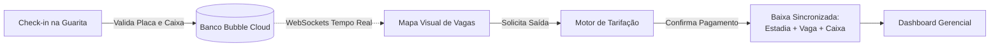

# 🅿️ SGE — Controle de Pátio e Caixa para Estacionamentos

Aplicação web *full-stack* construída visualmente no **Bubble.io** (*Low-Code* + **Agente de IA**) para substituir comandas de papel e planilhas em estacionamentos de pequeno e médio porte.

O sistema controla a entrada e saída de veículos pela placa, atualiza o mapa de vagas em tempo real, calcula tarifas automaticamente (tolerância, hora base, frações e teto de diária) e blinda o fechamento de caixa contra erros manuais e exclusões indevidas.

**Autor:** Everton Wesley Pereira Oliveira

## 🎯 O Problema e a Proposta

Estacionamentos menores costumam operar no caderno por não conseguirem pagar por cancelas automáticas, sensores de solo ou *softwares* pesados. Isso gera perda de dinheiro no cálculo mental de frações de hora e falta de controle no caixa.

* **O que o SGE resolve:** entrega um painel rápido de portaria, cálculo automático de cobrança e relatórios gerenciais rodando direto no navegador, sem exigir nenhum equipamento especial.

* **O que fica de fora:** integração com cancelas físicas, sensores por vaga, leitura de placa por câmera dedicada e emissão de nota fiscal.

## 🏗️ Arquitetura e Estrutura no Bubble.io

O projeto funciona como uma *Single Page Application* (SPA) para garantir troca instantânea de telas durante o atendimento na guarita.



### Banco de Dados Relacional (*Data Types* & *Option Sets*)

As listas fixas usam **Option Sets** (em cache, sem custo de busca): `Perfil` (*Operador*, *Gestor*), `Categoria` (*Automóvel*, *Motocicleta*, *Utilitário*), `Pagamento` (*Dinheiro*, *Pix*, *Débito*, *Crédito*) e `Status` (*Em Pátio*, *Finalizado*).

| *Data Type* | Campos Principais | Papel no Sistema | 
| ----- | ----- | ----- | 
| **`Tarifa`** | `categoria`, `valor_hora_base`, `valor_fracao`, `tempo_fracao_min`, `tempo_tolerancia`, `valor_diaria`, `ativa` | Define as regras de preço vigentes para cada tipo de veículo. | 
| **`Vaga`** | `codigo` (ex.: A01), `ocupada` (yes/no) | Controla a cor e disponibilidade dos espaços no pátio. | 
| **`Caixa`** | `data_abertura`, `data_fechamento`, `saldo_inicial`, `total_faturado`, `aberto`, `operador` | Registra o turno financeiro de cada atendente. | 
| **`Movimentacao`** | `placa`, `modelo_cor`, `entrada`, `saida`, `valor_cobrado`, `pago`, `vaga_vinculada`, `caixa_vinculado`, `tarifa_aplicada` | Guarda o histórico completo da estadia e amarra o pagamento ao turno. | 

## 🤖 Motor de Tarifação e Agente de IA

A lógica de cobrança e as regras de negócio foram estruturadas e refinadas com o auxílio de um **Agente de IA**, utilizado para traduzir a modelagem matemática de estacionamento para a sintaxe do *Expression Composer* do Bubble.

| Versão | Evolução da Lógica com o Agente de IA | Resultado Prático (Teste de 80 min) | 
| ----- | ----- | ----- | 
| **v1** | Subtração simples de horário (`saida - entrada`) multiplicada pelo valor da hora. | Cobrou **R\$ 13,33** (divisão quebrada, ignorando blocos de 15 min). | 
| **v2** | Inclusão de isenção por tolerância, arredondamento para cima (`:ceiling`) nas frações e trava de teto diário (`:min`). | Cobrou **R\$ 16,00** exatos (Hora base R\$ 10 + 2 frações de R\$ 3). | 

**Fórmula dinâmica aplicada no *Workflow* (acima de 60 min):**

```text
Tarifa's valor_hora_base + (((minutos_permanencia - 60) / Tarifa's tempo_fracao_min):ceiling * Tarifa's valor_fracao):min(Tarifa's valor_diaria)
```

## 🛡️ Blindagem de Caixa e Validações

Nenhuma regra crítica confia apenas na tela. As travas rodam nos *Workflows* e nas **Privacy Rules** do servidor do Bubble:

| Proteção | Como foi implementada | O que evita | 
| ----- | ----- | ----- | 
| **Padronização de Placa** | Operador `:trimmed:uppercase` ao digitar e salvar | Cadastrar `abc1234` quando `ABC1234` já está estacionado. | 
| **Bloqueio de Duplicidade** | Condição `Search for Movimentacoes (placa = Input, status = Em Pátio):count is 0` | Dar entrada duas vezes no mesmo carro sem registrar a saída anterior. | 
| **Exigência de Turno** | Check-in e Checkout só rodam se houver `Caixa` com `aberto = yes` para o usuário | Receber pagamentos sem um caixa aberto para auditar depois. | 
| **Relógio do Servidor** | Gravação de entrada e saída usando `Current date/time` do Bubble | Fraude mudando a hora do computador da portaria para cobrar menos. | 
| **Imutabilidade Financeira** | Permissão *Delete via workflows* desmarcada nas *Privacy Rules* para `Operador` | Operador apagar uma saída paga em dinheiro para ficar com o valor. | 
| **Preços Protegidos** | Edição de `Tarifa` restrita à condição `Current User's perfil is Gestor` | Alteração não autorizada no valor da hora ou da tolerância. | 

## 🧪 Resultados dos Testes

Cenário de referência utilizado: **Hora Base = R\$ 10,00 | Fração (15 min) = R\$ 3,00 | Tolerância = 10 min | Diária = R\$ 40,00**.

| Cenário Testado | Comportamento Esperado | Status | 
| ----- | ----- | ----- | 
| Entrada sem caixa aberto | Bloquear operação e pedir abertura de turno | ✅ Passou | 
| Entrada da placa `BRA2E19` na vaga `A01` | Vaga muda para vermelho em tempo real via *WebSockets* | ✅ Passou | 
| Tentativa de repetir a placa `bra2e19` ainda no pátio | Barrar registro mesmo digitando em minúsculas | ✅ Passou | 
| Saída com **8 min** de permanência | Aplicar tolerância e cobrar **R\$ 0,00** | ✅ Passou | 
| Saída com **45 min** de permanência | Cobrar valor fechado da 1ª hora (**R\$ 10,00**) | ✅ Passou | 
| Saída com **80 min** (1h20) pagando no Pix | Somar hora base + 2 frações (**R\$ 16,00**) e creditar no caixa | ✅ Passou | 
| Saída após **7 horas** (420 min) | Travar no teto da diária (**R\$ 40,00**) em vez de R\$ 82,00 | ✅ Passou | 
| Login como `Operador` tentando excluir registro ou editar tarifa | Opções ocultas na UI e negadas pelas *Privacy Rules* | ✅ Passou | 

## 🐞 Desafios Técnicos e Correções na Plataforma

Durante a construção no Bubble, alguns comportamentos nativos da ferramenta geraram bugs silenciosos que precisaram ser contornados:

1. **Busca sensível a maiúsculas/minúsculas:** O filtro padrão deixava passar placas repetidas se fossem digitadas em caixa baixa. *Solução:* Forçar `:uppercase` no *input* e na busca.

2. **Ordem matemática da esquerda para a direita:** O Bubble não respeita precedência algébrica comum por padrão, o que fazia o cálculo ignorar o teto da diária. *Solução:* Ativar o recurso *Use parentheses in dynamic expressions* em *Settings > Versions*.

3. **Vaga presa como "Ocupada" após o pagamento:** O passo que liberava a vaga lia os dados do *Popup*, que já havia sido fechado/limpo no passo anterior. *Solução:* Mudar a referência para `Result of step 1's vaga_vinculada`.

4. **Vazamento de dados entre turnos:** Por padrão, novos *Data Types* vêm visíveis para todos. *Solução:* Fechar as *Privacy Rules* da tabela `Caixa` para que o operador veja apenas os próprios turnos (`This Caixa's operador is Current User`).

## 💡 Balanço: Valeu a pena usar o Bubble?

**Pontos Fortes:**

* **Zero infraestrutura:** Banco de dados, autenticação e tela responsiva prontos sem configurar servidor.

* **Pátio ao vivo sem código extra:** A atualização automática do Bubble (*WebSockets*) muda a cor das vagas em todas as telas abertas no instante do *check-in*.

* **Auditoria fácil:** O *Debugger* em modo *Step-by-step* permitiu inspecionar cada variável do cálculo de tarifa sem precisar de *logs* no terminal.

**Limitações Encontradas:**

* **Fórmulas longas:** Regras matemáticas com múltiplos arredondamentos ficam verbosas no construtor visual do Bubble.

* **Dependência de internet e plataforma:** Se a conexão do estacionamento cair, o sistema para; além disso, o projeto não pode ser exportado como código para rodar fora do Bubble (*vendor lock-in*).

## 🚀 Evoluções Futuras

* Impressão direta de comprovante térmico (58mm/80mm) na entrada e saída.

* Cadastro de **Mensalistas** e **Convênios** com baixa automática pela placa.

* Alerta automático à meia-noite para veículos que pernoitaram no pátio.

* Geração de *QR Code* Pix dinâmico direto no modal de cobrança.

## ▶️ Guia Rápido de Reprodução

1. Crie um app no **Bubble.io** e ative os parênteses dinâmicos em *Settings > Versions*.

2. Cadastre os 4 **Option Sets** (`Perfil`, `Categoria`, `Pagamento`, `Status`) e os 4 **Data Types** (`Tarifa`, `Vaga`, `Caixa`, `Movimentacao`).

3. Configure as **Privacy Rules** restringindo exclusões e separando `Operador` de `Gestor`.

4. Monte a página única (`app`) em *Flexbox* com o formulário de entrada, o *Repeating Group* de vagas, o modal `Popup_Checkout` e a aba de gráficos (*plugin* **Chart Element**).

5. Adicione a fórmula de tarifação no *Workflow* do botão de saída e encadeie a baixa (`Movimentacao` $\rightarrow$ `Vaga` $\rightarrow$ `Caixa`).
