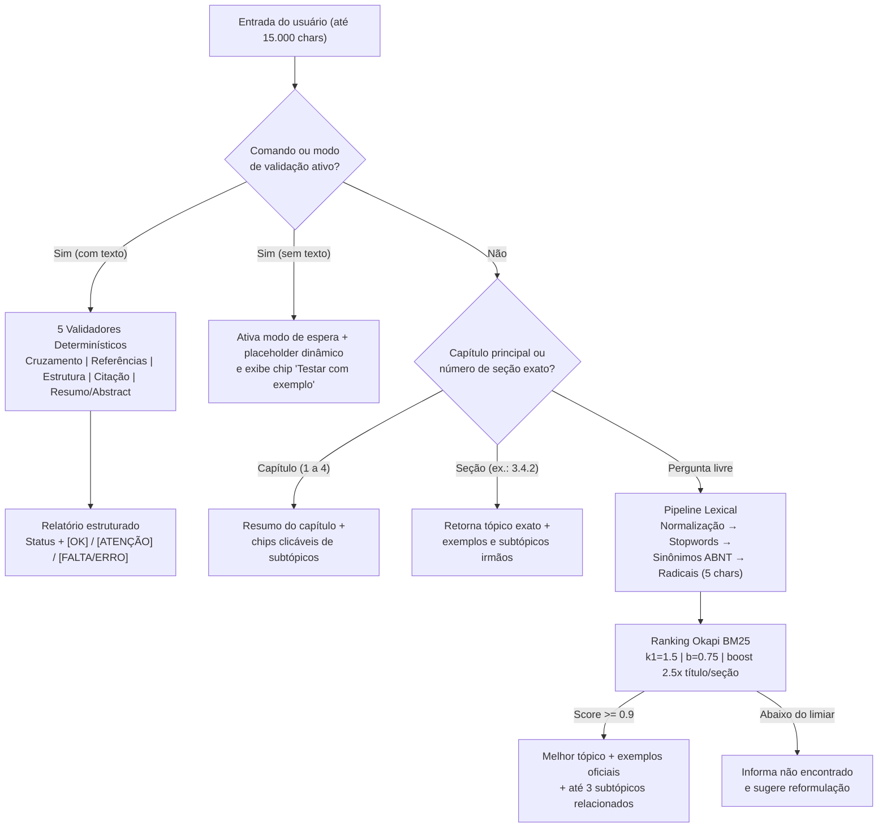

# Assistente do Manual de TCC — UDF


-15803d?style=flat-square)

Agente conversacional em **4 camadas** (**Perceptiva → Cognitiva → Decisória → Executiva**), leve e **100% funcional offline** (com **Modo 2 de Prompt Dinâmico / IA Generativa opcional**), para consultar todas as normas do **Manual de Elaboração de Trabalhos Acadêmicos da UDF (Brasília, 2020)** e auditar trechos reais de TCC (**Cruzar Citações × Referências**, **Referências Individual ou Lista A–Z**, **Sumário e Estrutura**, **Citação** e **Resumo/Abstract**) com **Interpretabilidade**, **Memória em 3 dimensões**, **Guardrails Adversariais** e **Guia Passo a Passo de Correção offline**.

---

## 1. Visão Geral e Motivação

Durante a redação de um Trabalho de Conclusão de Curso (TCC), estudantes frequentemente interrompem a escrita para conferir detalhes recorrentes das normas da ABNT: tamanho das margens, número mínimo de palavras no resumo, uso de `et al.` ou `apud`, formatação de citações diretas longas, ordem alfabética da lista de referências e consistência entre o que foi citado no texto e o que consta nas Referências.

O **Assistente do Manual de TCC — UDF** resolve esse problema oferecendo em uma única interface web offline (que funciona com duplo clique em `index.html`, via `file://`):
- **Consulta instantânea** por navegação estruturada (capítulos e subtópicos) ou busca em linguagem natural via algoritmo **Okapi BM25**.
- **5 validadores determinísticos** de alto peso técnico para auditar trechos reais do TCC (com suporte a até **15.000 caracteres** por envio), devolvendo um relatório visual com indicação exata da seção e página do manual.

### Público-alvo
Estudantes de graduação e pós-graduação, orientadores e revisores acadêmicos que precisam de um guia rápido, confiável e fiel ao padrão institucional da UDF.

### Fonte oficial exclusiva
Todo o conteúdo, exemplos e regras de validação foram extraídos fielmente de:

> **BIBLIOTECA GOVERNADOR EURICO REZENDE (UDF).** *Manual para elaboração de trabalhos acadêmicos: compilação das normas da ABNT.* Brasília: Centro Universitário do Distrito Federal – UDF, 2020.

**Normas ABNT compiladas no manual:**
- `ABNT NBR 6023:2018` — Informação e documentação: referências (elaboração)
- `ABNT NBR 6024:2003` — Numeração progressiva das seções de um documento escrito
- `ABNT NBR 6027:2003` — Sumário (apresentação)
- `ABNT NBR 6028:2003` — Resumo (apresentação)
- `ABNT NBR 6034:2004` — Índice (apresentação)
- `ABNT NBR 10520:2002` — Citações em documentos (apresentação)
- `ABNT NBR 12225:2004` — Lombada (apresentação)
- `ABNT NBR 14724:2011` — Trabalhos acadêmicos (apresentação)

---

## 2. Funcionalidades Principais

- **Navegação pelos 4 capítulos e seus subtópicos:** sidebar fixa no desktop (e drawer retrátil no mobile) com acesso direto aos 4 grandes blocos do manual e chips clicáveis apenas para subtópicos.
- **Busca em linguagem natural ou por número de seção:** entende termos curtos (*"margens"*, *"apud"*), números exatos (*"seção 3.4.2"*, *"1.8"*) e perguntas longas (*"como faço para colocar uma citação direta com mais de três linhas no meu trabalho?"*).
- **5 validadores determinísticos com botão `"Testar com exemplo"`:** valida **Cruzar Citações × Referências**, **Referências (individual ou lista A–Z)**, **Sumário e Estrutura**, **Citação** e **Resumo e Abstract (PT/EN)**, com placeholder dinâmico no campo de entrada e relatório colorido (`Aprovado`, `Aprovado com ressalvas`, `Necessita correções`).
- **Cópia rápida de modelos ABNT:** blocos destacados de exemplos oficiais com botão **"Copiar"** e confirmação visual (`Copiado!`).
- **Interface moderna com tema claro e escuro:** alternância entre Light Mode e Dark Mode via variáveis CSS puras, botão **Nova conversa** e ícones 100% em SVG inline.
- **100% offline e zero dependências:** funciona abrindo `index.html` com duplo clique (`file://`), sem internet, sem CDN e sem `npm install`.

---

## 3. Cobertura Completa do Conteúdo (Mapa do Manual)

| Capítulo | Páginas | Conteúdo coberto em `manual-udf.js` |
| :--- | :---: | :--- |
| **1. Estrutura do TCC** | 6–11 | Divisão entre **Parte Externa** e **Parte Interna** (Pré-textuais, Textuais e Pós-textuais).<br>**Obrigatórios (10):** Capa, Folha de Rosto, Folha de Aprovação, Resumo na língua vernácula, Resumo em língua estrangeira, Sumário, Introdução, Desenvolvimento, Conclusão e Referências.<br>**Opcionais (13):** Lombada, Errata, Dedicatória, Agradecimentos, Epígrafe, Lista de ilustrações, Lista de tabelas, Lista de abreviaturas e siglas, Lista de símbolos, Glossário, Apêndice (elaborado pelo autor), Anexo (não elaborado pelo autor) e Índice.<br>Inclui ordem exata de Capa (`1.1`) e Folha de Rosto (`1.2`), regras do Resumo (`1.8`: 150–500 palavras, parágrafo único, 3ª pessoa, `Palavras-chave:`), Sumário (`1.14`) e Apêndice vs. Anexo (`1.17–1.18`). |
| **2. Referências (NBR 6023:2018)** | 12–31 | Regras gerais (alinhamento à esquerda, espaço simples, 1 linha em branco entre referências).<br>**Autoria (`2.1`):** pessoa física (1 a 3 autores separados por `;`, 4+ com todos ou 1º + `et al.`, `(Org.)`, `(Coord.)`, `(Comp.)`, `(Ed.)`), pessoa jurídica (extenso, sigla > 4 letras, órgão subordinado) e autor desconhecido (entrada pelo título; proibição de `"Anônimo"`).<br>**Ordenação (`2.2`):** Sistema Alfabético (traço sublinear de 6 espaços para mesma autoria) e Sistema Numérico.<br>**Todos os 20 modelos (`2.3.1`–`2.3.20`):** Artigo de periódico, Periódico online, Artigo de jornal, Jornal online, Bases de dados online, Blog, Capítulo de livro, Documento sonoro (CD, entrevista/palestra, música), E-books, Entrevista pessoal, Filme cinematográfico, Home page (sites), Ilustração, Jurisprudência, Legislação (leis, códigos, constituições e emendas), Livro, Norma técnica, Processo judicial, Trabalho acadêmico (TCC/dissertação/tese) e Trabalho de evento.<br>**Dados desconhecidos (`2.4`):** `[Cidade]`, `[S.l.]`, `[s.n.]`, `[S.l.: s.n.]`, omissão de editora igual ao autor e tabela completa de datas aproximadas (`[1973]`, `[1969?]`, `[1971 ou 1972]`, `[entre 1906 e 1912]`, `[ca. 1960]`, `[197-]`, `[197-?]`, `[18--]`, `[18--?]`). |
| **3. Citações (NBR 10520)** | 32–39 | **Sistemas de chamada (`3.1`):** Autor-Data (incl. sobrenomes iguais `3.1.1.1` e mesmo autor/mesmo ano com `a`/`b` `3.1.1.2`) e Numérico (`3.1.2`, proibido com notas explicativas; proibido misturar os dois sistemas).<br>**Notas de rodapé (`3.2`):** Notas de referência (`Id.`/`Idem`, `Ibid.`/`Ibidem`, `op. cit.`, `apud`) e Notas explicativas (nunca misturar).<br>**Tipos de citação:** Indireta (`3.3`), Direta curta (`3.4.1`: até 3 linhas, aspas duplas, aspas simples internas), Direta longa (`3.4.2`: > 3 linhas, recuo de 4 cm, fonte 10 ou 11, espaço simples, sem aspas) e Citação de citação (`3.5`: `apud`).<br>**Apresentação (`3.6`):** Supressão `[...]`, Interpolação `[acréscimo]` e Ênfase/Destaque (`grifo nosso` / `grifo do autor`). |
| **4. Formatação e Paginação (NBR 14724)** | 40–41 | **Formato (`4.1`):** papel A4 (21 × 29,7 cm), cor preta (outras cores só em ilustrações), margens 3 cm (esquerda/superior) e 2 cm (direita/inferior — invertidas no verso), fonte 12 (menor e uniforme para citações longas, rodapé, paginação, catalogação e legendas).<br>**Espaçamento (`4.2`):** 1,5 no texto geral; espaço simples em citações longas, rodapé, referências, legendas e natureza na folha de rosto; filete de 5 cm nas notas de rodapé (`4.2.1`); indicativos de seção (`4.2.2`), títulos sem número centralizados (`4.2.3`) e elementos sem título/número (`4.2.4`).<br>**Paginação (`4.3`):** pré-textuais contadas a partir da folha de rosto, sem exibir número; algarismos arábicos a partir da Introdução, canto superior direito, a 2 cm da borda superior e 2 cm da borda direita. |

---

## 4. Arquitetura Técnica e Como Funciona a Busca sem IA

O motor em `agente.js` opera de forma **100% determinística**, sem modelos probabilísticos externos nem chamadas de rede:



### Pipeline de processamento textual
1. **Normalização:** converte para minúsculas, remove diacríticos (`normalize('NFD')`) e elimina pontuações irrelevantes.
2. **Remoção de stopwords:** descarta palavras funcionais frequentes (*"como"*, *"qual"*, *"para"*, *"no"*, *"fazer"*) para manter o foco nos termos técnicos.
3. **Expansão de sinônimos acadêmicos:** aplica o dicionário `MANUAL_UDF.sinonimos` (suportando termos simples e compostos, como `abstract → resumo lingua estrangeira`, `site → home page sites`, `mais de 3 autores → mais tres autores pessoa fisica`, `recuo → citacao direta longa`).
4. **Redução a radicais simples (5 caracteres):** unifica flexões (*"margem"* e *"margens"* → `marge`, *"citação"* e *"citações"* → `citac`).
5. **Pontuação Okapi BM25 (`k1 = 1.5`, `b = 0.75`, `PESO_TITULO = 2.5`):** calcula a relevância de cada tópico combinando frequência ponderada do termo (com peso **2,5x** no título e número da seção), raridade no manual (`IDF`) e normalização pelo tamanho do texto.

---

## 5. Como Funcionam os 5 Validadores Determinísticos de TCC

Cada validador aplica regras verificáveis extraídas diretamente do Manual da UDF (2020) e classifica o resultado como **Aprovado** (0 erros e 0 atenções), **Aprovado com ressalvas** (0 erros e ≥ 1 atenção) ou **Necessita correções** (≥ 1 erro):

| Validador | Critérios `[OK]` | Critérios `[ATENÇÃO]` | Critérios `[FALTA/ERRO]` | Limites técnicos |
| :--- | :--- | :--- | :--- | :--- |
| **1. Cruzar Citações × Referências** (`Seções 2.2, 3.1 e 3.5`) | Contagem exata de citações (entre parênteses e narrativas) que conferem com a lista; tratamento de `apud` (exigindo apenas a obra consultada após `apud`); suporte a `et al.`, `2002a`/`2002b`, `[1993]` e traço sublinear `______.`; nenhuma referência sobrando. | Referências presentes na lista que não foram citadas no trecho colado (lembrando que no TCC completo todas devem ter sido citadas). | Citações no texto ausentes na lista de Referências (listando cada `AUTOR, ANO` faltante); mistura de sistema Autor-Data e Numérico; ausência de separador (`REFERÊNCIAS` ou `---`). | Faz o pareamento lexical entre o 1º sobrenome/entidade e o ano de publicação; nomes com grafia divergente entre texto e referência podem acusar ausência. |
| **2. Referências — Individual ou Lista A–Z** (`Seções 1.15, 2.1, 2.2 e 2.4`) | **Individual:** CAIXA ALTA, autores com `;`, ano, `Disponível em:` + `Acesso em:` (data abreviada) em URLs, `Cidade: Editora` ou `[S.l.]`/`[s.n.]`.<br>**Lista em lote:** ordem alfabética crescente A–Z (incluindo traço sublinear `______.` ordenado pelo título), ausência de duplicatas e auditoria completa de todos os itens. | Data em `Acesso em:` fora do formato abreviado (`24 out. 2026`); ausência de `Cidade: Editora` em obra não online. | Uso proibido de `"Anônimo"`; entrada fora de CAIXA ALTA; autores com `e`/`&`; ano ausente; URL sem `Disponível em:` ou `Acesso em:`; item fora de ordem alfabética (apontando exatamente qual entrada está fora); referência duplicada; mistura de lista numerada com não numerada. | Texto puro não verifica negrito/itálico nem valida a existência real das obras citadas. |
| **3. Sumário e Estrutura** (`Seções 1, 1.14, 1.17–1.18, 4.2.2–4.2.3`) | Presença dos 10 elementos obrigatórios; identificação dos opcionais; nenhum pré-textual numerado; sequência progressiva sem saltos; `APÊNDICE A –` / `ANEXO A –` corretos. | `APÊNDICE A Título` sem travessão separando a letra do título. | Elementos obrigatórios faltando; pré-textuais numerados no sumário (`1 Resumo`); títulos sem indicativo numerados (`5 Referências`, `6 Apêndice`); saltos na numeração (`1` → `3` ou `2.1` → `2.3`); separador inválido após número (`1. Introdução`, `1 - Introdução`, `1) Introdução`); numeração indevida em `APÊNDICE 1` / `ANEXO 2`. | Baseia-se nos nomes/títulos das linhas coladas (aceita sinônimos usuais como *Referencial Teórico* / *Metodologia* para Desenvolvimento e *Considerações Finais* para Conclusão). |
| **4. Citação** (`Seção 3`) | Classificação estimada correta; aspas duplas em direta curta (≤ 3 linhas) ou sem aspas em longa (> 3 linhas) e indireta; chamada Autor-Data em CAIXA ALTA com ano de 4 dígitos; `p.` presente nas diretas; supressão com `[...]`; `apud` com dois anos. | Sistema numérico detectado (alerta contra notas explicativas); `apud` sem os dois anos identificáveis. | Aspas duplas em citação direta longa; aspas incompletas na curta; sobrenome em minúsculas nos parênteses; falta de chamada/ano; falta de `p.` em direta; mistura de Autor-Data e Numérico; reticências soltas `...` sem colchetes. | Estima o número de linhas considerando ~80 caracteres por linha em folha A4/fonte 12; recuo de 4 cm e fonte 10/11 devem ser conferidos no editor. |
| **5. Resumo e Abstract** (`Seções 1.8 e 1.9`) | Detecção automática de idioma (**PT** ou **EN**); 150 a 500 palavras; parágrafo único; `Palavras-chave:` (PT) ou `Keywords:` (EN) separadas e finalizadas por ponto; ausência de 1ª pessoa (PT e EN); indícios dos 4 pilares (objetivo/objective, método/method, resultados/results, conclusão/conclusion). | Múltiplos parágrafos antes das palavras-chave; ausência aparente de algum dos 4 pilares de conteúdo. | Menos de 150 ou mais de 500 palavras; `Palavras-chave:`/`Keywords:` ausentes, vazias, com vírgula/ponto e vírgula ou sem ponto final; uso de 1ª pessoa em português (`eu`, `nós`, `desenvolvi`...) ou inglês (`I`, `we`, `my`, `our`...). | Verifica presença lexical de termos indicativos dos 4 pilares; não avalia fluência gramatical ou mérito científico. |

---

## 6. Estrutura de Arquivos do Projeto

```text
bot-duvidas/
├── index.html                           # App web responsivo (4 camadas, 2 modos, modal Ética/Memória, Feedback Loop, Light/Dark Mode)
├── manual-udf.js                        # Base oficial dos 4 capítulos (52 tópicos) do Manual de TCC da UDF (2020) + 102 sinônimos ABNT
├── agente.js                            # Agente 4 camadas, Okapi BM25, Memória Curta/Média/Longa, Guardrails, 5 Validadores, Guia Offline e Prompt Dinâmico
├── testes.js                            # Suíte com 52 testes automatizados (funcionais, memória, adversariais e stress)
├── package.json                         # Metadados do projeto e script `npm test`
├── .gitignore                           # Proteção contra arquivos temporários e `.env`
├── UNIDADE_IV_AGENTES_ETICA_PROJETO.md  # Entrega completa da Unidade IV alinhada ao Guia de Estudos A1 (UDF)
├── README.md                            # Documentação técnica completa do projeto
└── LICENSE                              # Licença MIT
```

---

## 7. Como Executar, Testar e Publicar

### Executar localmente no navegador (100% offline via `file://`)
1. Clone ou baixe o repositório.
2. Dê duplo clique no arquivo `index.html` para abri-lo diretamente no navegador (`file://`).
3. No **Modo 1 (padrão)**, tudo funciona **100% offline** sem servidor, sem API e sem instalação de pacotes.
4. No **Modo 2 (`Prompt Dinâmico / IA`)**, você pode **copiar o Prompt Dinâmico Parametrizado** (100% offline, pronto para qualquer LLM) ou, opcionalmente, informar uma chave de API gratuita (**Groq** ou **Gemini**, mantida apenas na RAM da aba) com *fallback* automático para o Modo 1 Offline.

### Rodar os testes automatizados (Node.js puro)
A partir da pasta do projeto, execute:

```bash
node testes.js
# ou: npm test
```

**Saída esperada:** `Resultado: 52 de 52 aprovados`

**O que os 52 testes cobrem:**
- **Navegação e busca BM25 (16 casos):** saudação, os 4 capítulos, busca exata por seção (`3.4.2`, `1.8`), perguntas curtas, longas, sinônimos, paginação, apêndice vs. anexo e perguntas fora do escopo.
- **5 Validadores + Fluxos conversacionais (27 casos):** Resumo/Abstract (5), Citação (3), Referências individual e A–Z (6), Sumário/Estrutura (5), Cruzamento Citações × Referências (6) e comandos interativos/inline + limite de 15.000 chars (2).
- **Arquitetura 4 Camadas, Memória e Feedback (3 casos):** rastreio de interpretabilidade (`Perceptiva → Cognitiva → Decisória → Executiva`), Memória Curta/Média com acompanhamento (`"qual a página?"`, `"e o exemplo?"`), Memória Longa desativada por padrão e Feedback Loop/Remediação.
- **Guia de Correção Offline, Prompt Dinâmico e Modo IA (3 casos):** plano passo a passo local sem API, template parametrizado com contexto BM25/memória e chamada opcional com *fallback* offline automático.
- **Testes Adversariais e Teste de Stress (3 casos):** bloqueio de *prompt injection*, recusa de plágio/fabricação de referências e stress test com 200 consultas consecutivas + texto > 15.000 caracteres.

### Publicar no GitHub Pages
1. No repositório do GitHub, acesse **Settings → Pages**.
2. Em **Build and deployment**, selecione **Deploy from a branch**, escolha `main` e a pasta `/ (root)`, e clique em **Save**.
3. Aguarde ~1–2 minutos e acesse:
   - Se `index.html` estiver na raiz: `https://<seu-usuario>.github.io/<nome-do-repo>/`
   - Se estiver na subpasta `bot-duvidas/`: `https://<seu-usuario>.github.io/<nome-do-repo>/bot-duvidas/`

---

## 8. Guia Rápido de Uso e Exemplos de Comandos

| Objetivo | Exemplo do que digitar ou clicar | Resultado esperado |
| :--- | :--- | :--- |
| **Navegar por capítulo** | Clique em `2. Referências` na sidebar | Exibe o resumo do capítulo e chips de todos os subtópicos/modelos |
| **Pergunta curta** | `qual o tamanho da margem?` | Abre `4.1 Formato, Papel, Margens e Fonte` (3 cm / 2 cm, A4, fonte 12) |
| **Pergunta longa** | `como faço para colocar uma citação direta com mais de três linhas no meu trabalho?` | Abre `3.4.2 Citação Direta Longa` (recuo 4 cm, fonte 10/11, sem aspas) |
| **Busca por seção** | `seção 3.4.2` ou `1.8` ou `2.3.12` | Abre diretamente a seção correspondente do manual |
| **Cruzar Citações × Referências** | Clique em `Cruzar Citações × Referências` (ou digite `/validar cruzamento`), cole o texto, escreva `REFERÊNCIAS` em uma linha e cole a lista | Aponta citações ausentes nas referências, referências não citadas, regra de `apud` e mistura de sistemas |
| **Validar Lista de Referências (A–Z)** | Clique em `Referências` (ou `validar referencia: ...`) e cole várias referências separadas por quebra de linha | Confere ordem alfabética, traço sublinear `______.`, duplicatas e regras de cada item |
| **Validar Sumário e Estrutura** | Clique em `Sumário e Estrutura` (ou `/validar estrutura`) e cole seu sumário | Confere os 10 obrigatórios, saltos (`1` → `3`), separadores (`1.`), `5 Referências` e `APÊNDICE A –` |
| **Validar Citação** | Clique em `Citação` (ou `validar citacao: ...`) e cole o trecho citado | Classifica e valida aspas, CAIXA ALTA, página, `[...]` e `apud` |
| **Validar Resumo ou Abstract** | Clique em `Resumo e Abstract` (ou `validar resumo: ...`) e cole texto em PT ou EN | Detecta idioma automaticamente e valida 150–500 palavras, parágrafo único, 1ª pessoa e `Palavras-chave:`/`Keywords:` |
| **Testar na hora** | Ao clicar em qualquer validador, clique no chip **`Testar com exemplo`** | Envia um caso realista de demonstração e exibe o relatório visual completo |

---

## 9. Interface, Acessibilidade e Privacidade

- **UX/UI limpo e sem redundâncias:** layout em tela cheia (`100dvh`) com sidebar única (zero botões duplicados e zero frases/rodapé abaixo do composer), 5 validadores com ícones SVG exclusivos e subtítulos claros, placeholder dinâmico no campo de envio, ajuste automático de altura do `<textarea>`, contador tabular (`0 / 15000`) e suporte a **Light Mode** e **Dark Mode**.
- **Acessibilidade:** navegação por teclado com `:focus-visible` nítido, contraste WCAG AA nos dois temas, semântica HTML5, atributos ARIA (`role="log"`, `aria-live="polite"`, `aria-pressed`, `aria-expanded`, `aria-controls`) e respeito a `prefers-reduced-motion`.
- **Privacidade por arquitetura:** toda a execução acontece **100% localmente no navegador** (inclusive via `file://`). Nenhum trecho do TCC do estudante sai da máquina, vai para APIs externas ou fica gravado em `localStorage` — ao clicar em **Nova conversa** ou recarregar a aba, a memória da sessão é limpa.

---

## 10. Limitações Conhecidas (Transparência Técnica)

- **Busca lexical sem compreensão semântica (sem IA):** o BM25 depende da coincidência de radicais e do dicionário de sinônimos; perguntas formuladas sem nenhum termo próximo ao vocabulário da ABNT podem exigir reformulação ou navegação pela sidebar.
- **Validação por regras heurísticas de texto puro:** os validadores auditam padrões objetivos da norma (extensão, ordem alfabética, consistência de citações, numeração progressiva, pontuação, caixa alta), mas não avaliam mérito científico, gramática profunda ou formatação visual de arquivos `.docx` (como margens reais em centímetros, negrito ou itálico).
- **Estimativa aproximada de linhas em citações:** a separação entre citação direta curta (até 3 linhas) e longa (mais de 3 linhas) utiliza a aproximação de ~80 caracteres por linha em página A4 com fonte 12.
- **Referência normativa de 2020:** o conteúdo reflete fielmente o Manual da UDF publicado em 2020. Recomenda-se sempre a revisão final junto ao professor orientador e eventuais atualizações publicadas pela Biblioteca da UDF.

---

## 11. Como Estender ou Atualizar o Manual

1. **Adicionar ou editar tópicos (`manual-udf.js`):** inclua um novo objeto no array `MANUAL_UDF.topicos` seguindo o formato:
   ```javascript
   {
     id: '2-3-21-novo-modelo',
     capitulo: 'referencias', // 'estrutura' | 'referencias' | 'citacoes' | 'apresentacao'
     secao: '2.3.21',
     secoes: ['2.3.21'],
     titulo: '2.3.21 Novo Modelo de Documento',
     paginas: 'pág. XX',
     conteudo: 'Descrição da regra e estrutura...',
     exemplos: 'EXEMPLO, Autor. Título...'
   }
   ```
   O índice BM25 em `agente.js` passará a indexar o novo tópico automaticamente.
2. **Ampliar cobertura de busca (`manual-udf.js`):** adicione novos pares em `MANUAL_UDF.sinonimos` (chaves em minúsculas e sem acento).
3. **Garantir regressão zero (`testes.js`):** registre novos testes com `registrarTeste(...)` e execute `node testes.js` para validar todas as regras.

---

## 12. Licença e Créditos

- **Licença:** distribuído sob a [Licença MIT](LICENSE).
- **Créditos do conteúdo normativo:** *Manual para Elaboração de Trabalhos Acadêmicos: compilação das normas da ABNT* — Organização: **Biblioteca Governador Eurico Rezende**, Centro Universitário do Distrito Federal (**UDF**), Brasília, 2020.

> **Uso de IA:** o código e a documentação foram desenvolvidos com apoio de IA generativa (Gemini) e revisados pela equipe. Em tempo de execução, o assistente opera de forma 100% determinística e offline, sem uso de IA.
